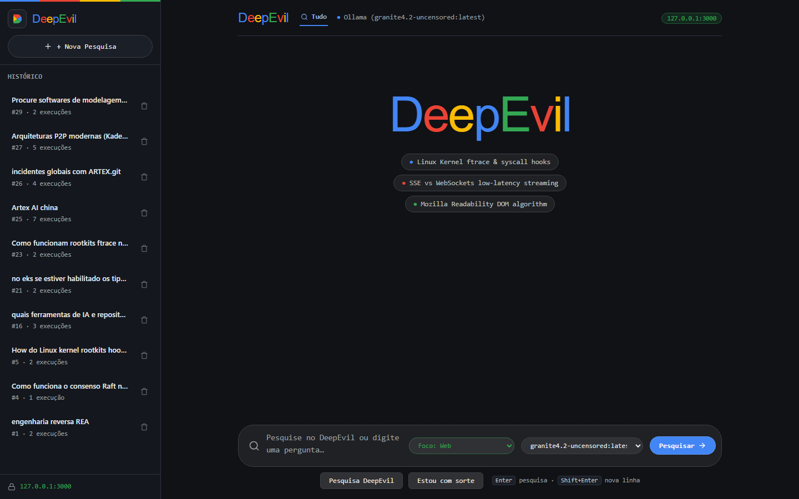
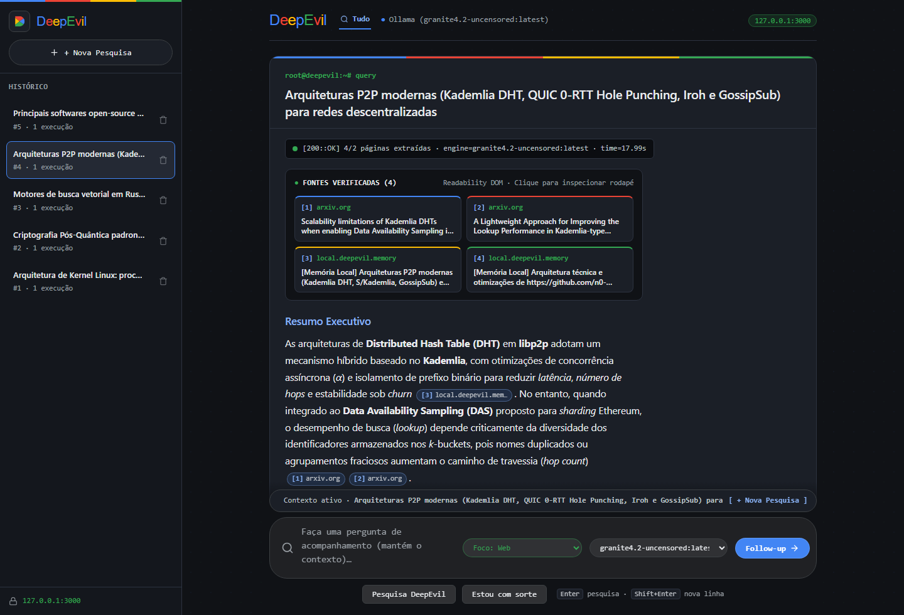
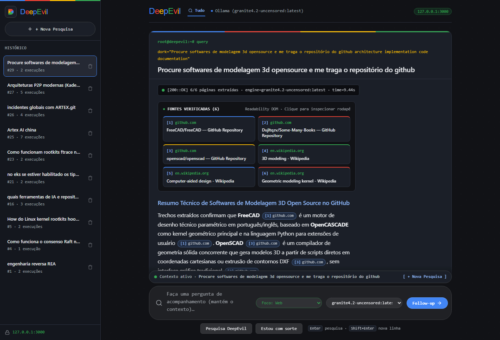
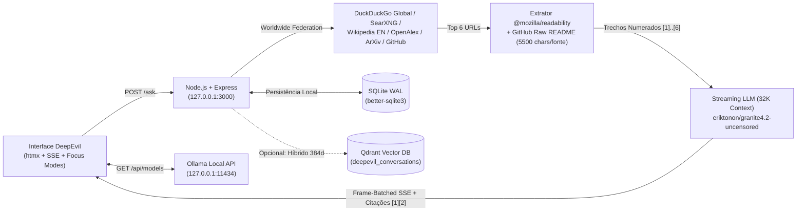

# DeepEvil — Worldwide Research & Local AI Answer Engine

<p align="left">
  <strong>Architected by Erik Tonon</strong> · <strong>EdgeSearch &amp; PE-AGENTS-IBM Ecosystem</strong><br>
  <em>Worldwide Research Federation · 100% Local AI via Ollama (`eriktonon/granite4.2-uncensored` 32K) · Zero Telemetry · SQLite WAL + Optional Qdrant Vector DB</em>
</p>

---

## O que é o DeepEvil?

O **DeepEvil** é um mecanismo de pesquisa técnica, científica e de engenharia (*Worldwide AI Answer Engine*) que roda **100% localmente** na sua máquina (`http://localhost:3000`), sem mensalidades de API e sem telemetria externa.

Combinando uma federação global de busca sem trava regional (**DuckDuckGo Worldwide**, **Wikipedia EN**, **OpenAlex 250M+ papers**, **ArXiv**, **GitHub API**, **HackerNews** e **SearXNG**) com o modelo local **`eriktonon/granite4.2-uncensored`** (janela de **32.768 tokens** no **Ollama**), o DeepEvil lê o conteúdo real das páginas via `@mozilla/readability` e gera respostas técnicas densas, em tempo real via **Server-Sent Events (SSE)**, com citações verificadas `[1][2]` e cartões de preview interativos.

### Destaques Principais
- **Federação Global em 7 Polos Mundiais (`🇺🇸 US · 🇨🇳 CN · 🇩🇪 DE · 🇯🇵 JP · 🇰🇷 KR · 🇷🇺 RU · 🇧🇷 BR`)**: Rompe a bolha geográfica buscando simultaneamente nos principais centros tecnológicos e acadêmicos do mundo — **EUA** (OpenAlex US, ArXiv, HackerNews, Wikipedia EN), **China** (OpenAlex CN, Wikipedia ZH, GitHub Global), **Alemanha** (Max Planck, Fraunhofer, TUM, DFKI, OpenAlex DE, Wikipedia DE), **Japão** (RIKEN, UTokyo, NII, OpenAlex JP, Wikipedia JA), **Coreia do Sul** (KAIST, SNU, ETRI, OpenAlex KR, Wikipedia KO), **Rússia** (Habr Engineering, OpenAlex RU, Wikipedia RU) e **Brasil** (USP, UNICAMP, PUC-Rio, OpenAlex BR, Wikipedia PT).
- **Tradução Automática de Headlines (`localizeSourceHeadlines`) & Seletor de Idioma (`searchLang`)**: Títulos de artigos e papers internacionais (em mandarim, japonês, coreano, alemão, russo ou inglês) têm o assunto traduzido automaticamente para o idioma selecionado na busca (`Português`, `English`, `Español`, `Deutsch`, `日本語`, `한국어`, `中文`, `Русский`), preservando a flag do país (`[🇩🇪 DE]`, `[🇯🇵 JP]`, `[🇰🇷 KR]`) e o nome original de repositórios (`owner/repo`).
- **2-Tier Obsidian Command Deck UI (`/taste-design-direction`)**: Cápsula de comando em 2 andares com 100% da largura dedicada ao input de pesquisa no Tier 1 e seletores táticos independentes no Tier 2 (`ESCOPO`, `IDIOMA`, `FOCO`, `LLM`).
- **Filtro de Escopo Geopolítico (`searchScope`)**: Alterne entre `Global · 7 Polos (US·CN·DE·JP·KR·RU·BR)`, `Só Externo (US·CN·DE·JP·KR·RU)` ou `Só Brasil (PT-BR)`.
- **Extração Direta de Repositórios GitHub**: Detecta URLs ou pedidos de código open-source, consulta a API do GitHub ordenada por estrelas (`sort=stars`) e extrai o `README.md` completo via `raw.githubusercontent.com`.
- **5 Modos de Foco (`Focus Modes`)**: `Web Global`, `SecOps / CVE`, `Code / Docs`, `Academic` e `Híbrido (Local + Web)`.
- **Motor LLM Local de 32K (`eriktonon/granite4.2-uncensored`)**: Baseado no IBM Granite 4.2 8B com *Orthogonal Refusal Abliteration* + *SecOps LoRA*, configurado com `num_ctx=32768`, `repeat_penalty=1.12` e isolamento estrito de citações entre turnos.
- **Seletor Multi-LLM Ao Vivo**: Troque de modelo a qualquer momento direto na interface (qualquer modelo instalado no seu Ollama local, ou opcionalmente Claude / OpenAI), além de botão **Regerar** (`0ms` de nova busca web) e **Traduzir** instantâneo (`PT`, `EN`, `ES`, `DE`, `JA`, `KO`, `ZH`, `RU`, `FR`).

---

## Interface & Demonstração Visual

### 1. Tela Inicial — 2-Tier Obsidian Command Deck (`ESCOPO`, `IDIOMA`, `FOCO`, `LLM`)


### 2. Pesquisa Global 7 Polos (🇺🇸 US · 🇨🇳 CN · 🇩🇪 DE · 🇯🇵 JP · 🇰🇷 KR · 🇷🇺 RU · 🇧🇷 BR) com Headlines Traduzidas


### 3. Descoberta Direta de Repositórios Open-Source no GitHub (Modelagem 3D & CAD)


---

## Passo a Passo: Como Instalar e Rodar Localmente com o Ollama

### Pré-requisitos
- **Node.js 20+** instalado ([nodejs.org](https://nodejs.org/))
- **Ollama** instalado ([ollama.com/download](https://ollama.com/download))
- **Git** instalado

---

### Passo 1: Instalar o Ollama e Baixar o Modelo `granite4.2-uncensored` (32K)

Com o Ollama instalado e rodando na sua máquina, abra o terminal (PowerShell, CMD, Linux ou macOS) e baixe o modelo oficial do DeepEvil publicado no Ollama Hub:

```bash
# 1. Baixe o modelo principal de 32K tokens (5.7 GB)
ollama pull eriktonon/granite4.2-uncensored:latest

# 2. (Opcional) Baixe o modelo de embeddings semânticos bge-m3 caso use Qdrant Vector DB
ollama pull bge-m3:latest
```

> **Dica:** Você também pode usar qualquer outro modelo que já tenha no seu Ollama (`qwen2.5-coder:14b`, `llama3.1`, `deepseek-r1`, `mistral-nemo`, etc.) selecionando-o diretamente no menu suspenso da interface do DeepEvil.

---

### Passo 2: Clonar o Repositório e Instalar as Dependências

```bash
# Clone o repositório oficial
git clone https://github.com/eriktonon/deepevil.git
cd deepevil

# Instale as dependências Node.js
npm install
```

---

### Passo 3: Configurar o `.env` (Opcional — Funciona Zero-Config!)

O DeepEvil já funciona **sem precisar criar chaves de API**. Se quiser personalizar portas ou modelos, copie o arquivo de exemplo:

```bash
# Linux / macOS
cp .env.example .env

# Windows (PowerShell)
Copy-Item .env.example .env
```

Configuração padrão no `.env`:

```ini
PORT=3000
HOST=127.0.0.1

# Busca Global sem chave (keyless) ou SearXNG local (searxng)
SEARCH_PROVIDER=keyless
OLLAMA_BASE_URL=http://127.0.0.1:11434
OLLAMA_MODEL=eriktonon/granite4.2-uncensored:latest
OLLAMA_NUM_CTX=32768
MAX_CHARS_PER_SOURCE=5500
```

---

### Passo 4: Iniciar o DeepEvil

```bash
# Rodar a suíte de testes determinísticos (14 testes E2E)
npm test

# Iniciar o servidor
npm start
```

Abra no navegador:
👉 **`http://localhost:3000`**

---

## Executando via Docker Compose (Opcional com SearXNG Integrado)

Se preferir subir o **DeepEvil** junto com um container **SearXNG** dedicado:

```bash
docker compose up -d --build
```

---

## Arquitetura do Sistema



---

## Endpoints Principais

| Método | Rota | Descrição |
| :--- | :--- | :--- |
| `GET` | `/` | Interface principal do **DeepEvil** com seletor ao vivo de modelos Ollama e Focus Modes |
| `POST` | `/ask` | Inicia um novo turno de pesquisa global ou *follow-up* contextual |
| `GET` | `/stream/:turnId` | Stream SSE em tempo real (`status`, `sources`, `answer`, `done`) com Frame Batching (~24fps) |
| `POST` | `/turns/:turnId/rewrite` | Regera a resposta com outro modelo LLM reutilizando as fontes já extraídas (`0ms` de busca web) |
| `POST` | `/turns/:turnId/stop` | Interrompe imediatamente a geração de tokens em andamento |
| `GET` | `/turns/:turnId/translate/stream` | Tradução instantânea via SSE (`pt-BR`, `en`, `es`, `fr`, `de`) preservando citações `[1][2]` |
| `GET` | `/turns/:turnId/export.md` | Exporta o relatório técnico completo da pesquisa com fontes em Markdown (`.md`) |
| `GET` | `/api/models` | Lista dinamicamente todos os modelos disponíveis no Ollama local |
| `GET` | `/health` | Healthcheck consolidado do servidor, LLM e banco de dados |

---

## Licença & Autor

Desenvolvido por **Erik Tonon**  
Licenciado sob **Apache License 2.0** — veja o arquivo [LICENSE](LICENSE).  
Modelo Oficial no Ollama Hub: [`https://ollama.com/eriktonon/granite4.2-uncensored`](https://ollama.com/eriktonon/granite4.2-uncensored)
