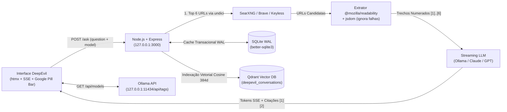

# DeepEvil — Enterprise Answer Engine (`localhost:3000`)

<p align="left">
  <strong>Architected by Erik Tonon</strong> · <strong>EdgeSearch &amp; PE-AGENTS-IBM Ecosystem</strong><br>
  <em>Build to Manage (BTM) · Zero Telemetry · Dual-Persistence (Qdrant Vector DB + SQLite WAL) · Live Ollama Multi-LLM Selector</em>
</p>

---

## Visão Geral

O **DeepEvil** é um mecanismo de respostas pessoal e corporativo (*Answer Engine*), projetado sob a filosofia **Build to Manage (BTM)** por **Erik Tonon**. Com a identidade minimalista e tipografia geométrica clássica nas 4 cores do Google (`#4285F4`, `#EA4335`, `#FBBC05`, `#34A853`) sobre tema escuro de alta precisão, o motor opera exclusivamente em `127.0.0.1:3000` sem telemetria externa.

Para cada pergunta submetida:
1. **Busca Web Multi-Provider (`undici`)**: Captura os **6 principais resultados** via **SearXNG JSON API** (`localhost:8888`), **Brave Search API** ou **Keyless Web Search** integrado.
2. **Extração Limpa de DOM (`@mozilla/readability` + `jsdom`)**: Faz o download concorrente das 6 páginas via `undici` e extrai exclusivamente o corpo legível do artigo. Páginas inacessíveis ou bloqueadas são descartadas silenciosamente e **jamais são citadas**.
3. **Seletor Dinâmico de LLM (Ollama / Anthropic / OpenAI)**: Consulta em tempo real a API local do **Ollama** (`GET http://127.0.0.1:11434/api/tags`) e permite selecionar na própria barra de pesquisa qual modelo executará a síntese (ex.: `granite4.2:latest`, `granite4.2:30b`, `gemma4:31b`, `qwen2.5-coder:14b`, `jarvis:14b-v4`, `mistral-nemo:latest`, etc.), entregando a resposta via **Server-Sent Events (SSE)** com citações verificadas `[1][2]`.
4. **Persistência Enterprise Híbrida (Qdrant Vector DB + SQLite WAL)**:
   - **Qdrant Vector DB (`http://127.0.0.1:6333` / `http://192.168.3.109:6333`)**: Indexa automaticamente cada turno concluído e cada fonte extraída pelo Readability na coleção vetorial `deepevil_conversations` (vetores Cosine de 384 dimensões), habilitando busca semântica via `/api/qdrant/search?q=...`.
   - **SQLite WAL (`better-sqlite3`)**: Mantém o cache transacional local de baixíssima latência (`data/perplexity.sqlite`) para a barra lateral de conversas (identificadas pela primeira pergunta feita) e o contexto completo de perguntas de acompanhamento (*follow-up*).

---

## Arquitetura do Sistema



---

## Configuração Rápida (`.env`)

Copie o arquivo `.env.example` para `.env`:

```bash
cp .env.example .env
```

### Variáveis Suportadas

```ini
PORT=3000
HOST=127.0.0.1

# Motor de Busca: searxng | brave | keyless
SEARCH_PROVIDER=keyless
SEARXNG_BASE_URL=http://127.0.0.1:8888
BRAVE_SEARCH_API_KEY=keyless

# Provedor de LLM: ollama | anthropic | openai
LLM_PROVIDER=ollama
OLLAMA_BASE_URL=http://127.0.0.1:11434
OLLAMA_MODEL=granite4.2:latest
OLLAMA_NUM_CTX=16384

# Persistência Vetorial Qdrant + SQLite WAL
QDRANT_URL=http://127.0.0.1:6333
QDRANT_COLLECTION=deepevil_conversations
SQLITE_DB_PATH=./data/perplexity.sqlite

# Opcional: Chaves Cloud caso deseje alternar do Ollama para APIs externas
ANTHROPIC_API_KEY=
ANTHROPIC_MODEL=claude-3-5-sonnet-latest
OPENAI_API_KEY=
OPENAI_MODEL=gpt-4o-mini
```

---

## Executando Localmente

```bash
# 1. Instalar dependências
npm install

# 2. Executar suíte de testes determinísticos (Node Test Runner)
npm test

# 3. Iniciar o servidor em http://localhost:3000
npm start
```

### Subindo o SearXNG Local (Opcional via Docker Compose)

```bash
docker compose up -d searxng
```

---

## Endpoints de API & Observabilidade

| Método | Rota | Descrição |
| :--- | :--- | :--- |
| `GET` | `/` | Interface principal do **DeepEvil** com seletor ao vivo de modelos Ollama |
| `POST` | `/ask` | Registra pergunta (inicial ou *follow-up*) com o modelo LLM selecionado |
| `GET` | `/stream/:turnId` | Stream SSE em tempo real (`status`, `sources`, `answer`, `done`) |
| `GET` | `/api/models` | Lista em tempo real os modelos instalados no servidor Ollama local |
| `GET` | `/api/qdrant/status` | Verifica conectividade, coleção e contagem de pontos no **Qdrant Vector DB** |
| `GET` | `/api/qdrant/search?q=...` | Executa busca vetorial semântica sobre respostas e fontes indexadas no Qdrant |
| `GET` | `/health` | Healthcheck BTM consolidado (Localhost Guard + LLM + Qdrant Vector DB) |

---

## Estimativa de Custo por Consulta

Cada consulta extrai até 6 páginas web (~6.500 tokens de entrada somando *system prompt*, histórico e trechos do Readability) e gera ~600 tokens de resposta com citações `[1][2]`:

| Configuração (Busca + LLM) | Custo de Busca | Custo de LLM | **Custo Total / Consulta** | **1.000 Consultas / Mês** |
| :--- | :---: | :---: | :---: | :---: |
| **Ollama Local + SearXNG / Keyless (Padrão)** | **US\$ 0,00** | **US\$ 0,00** | **US\$ 0,00 (R\$ 0,00)** | **US\$ 0,00** |
| **Brave Free Tier + OpenAI (`gpt-4o-mini`)** | US\$ 0,00 *(até 2.000/mês)* | ~US\$ 0,0013 | **~US\$ 0,0013** | **~US\$ 1,30** |
| **Brave Free Tier + Claude (`claude-3-5-sonnet`)** | US\$ 0,00 *(até 2.000/mês)* | ~US\$ 0,0285 | **~US\$ 0,0285** | **~US\$ 28,50** |
| **Brave Base Plan + OpenAI (`gpt-4o`)** | US\$ 0,0050 | ~US\$ 0,0222 | **~US\$ 0,0272** | **~US\$ 27,20** |

---

## Autor & Governança

Desenvolvido por **Erik Tonon**  
**EdgeSearch · PE-AGENTS-IBM Architecture · Build to Manage (BTM)**  
Repositório GitLab Homelab: `http://192.168.3.112/eriktonon/deepevil`
