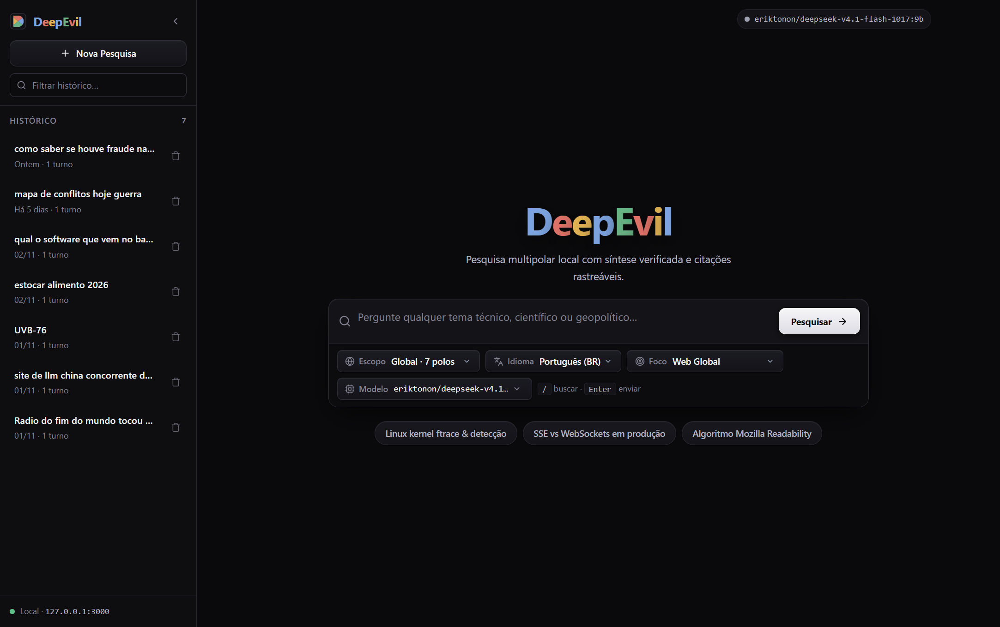
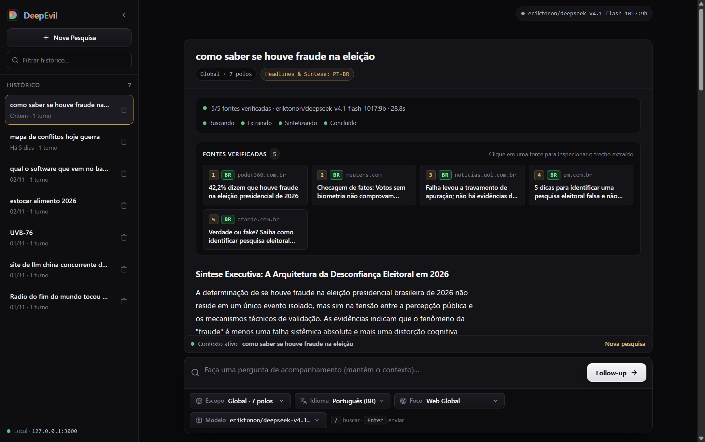
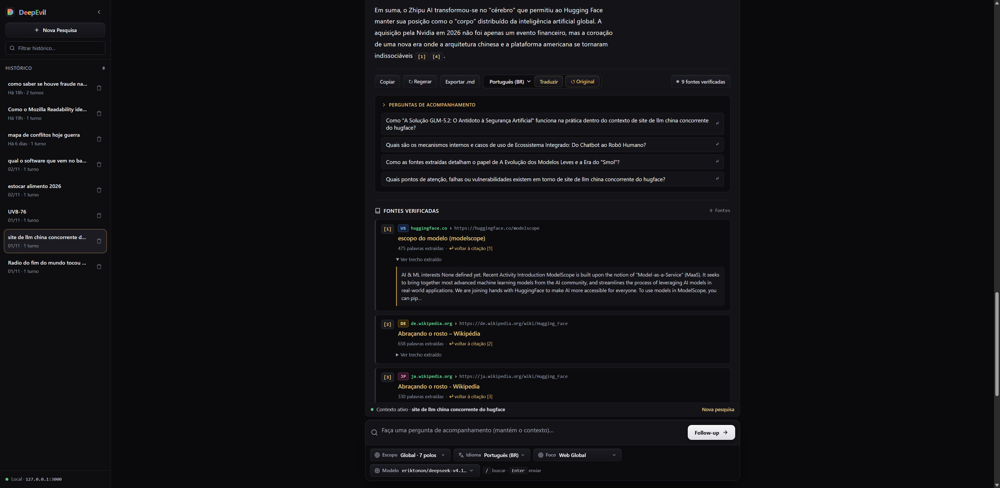
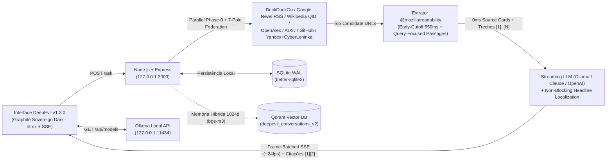

# DeepEvil v1.3.0 — Worldwide Research & Local AI Answer Engine (`Graphite & Obsidian Sovereign Dark`)

[](https://github.com/eriktonon/deepevil)
[-1b1b21?style=for-the-badge&labelColor=0a0a0c&color=7da4e0)](./public/styles.css)
[-141418?style=for-the-badge&labelColor=0a0a0c&color=69b385)](./tests)
[](./LICENSE)

<p align="left">
  <strong>Architected by Erik Tonon</strong> · <strong>EdgeSearch &amp; PE-AGENTS-IBM Ecosystem</strong><br>
  <em>7-Pole Worldwide Research Federation · 100% Local AI via Ollama (`eriktonon/granite4.2-uncensored` 32K &amp; 81+ Models) · Zero Telemetry · SQLite WAL + Qdrant Vector DB (`1024d` `bge-m3`)</em>
</p>

---

## O que é o DeepEvil?

O **DeepEvil (`v1.3.0`)** é um mecanismo de pesquisa técnica, científica, geopolítica e de engenharia (*Worldwide AI Answer Engine*) que roda **100% localmente** na sua máquina (`http://localhost:3000`), sem mensalidades de API e sem telemetria externa.

Combinando uma **federação multipolar de 7 polos globais** (**DuckDuckGo Worldwide**, **Google News RSS**, **Wikipedia Multi-Idioma com deduplicação Cross-Lingual QID**, **OpenAlex 250M+ papers**, **ArXiv**, **GitHub API**, **HackerNews**, **Yandex + CyberLeninka Runet 3-Tier** e **SearXNG**) com modelos locais no **Ollama** (`eriktonon/granite4.2-uncensored`, `eriktonon/deepseek-v4.1-flash-1017:9b`, `eriktonon/gemma4-uncensored:12b`, `eriktonon/qwen3.8-uncensored:9b`), o DeepEvil extrai o conteúdo real das páginas via `@mozilla/readability` com *Early-Cutoff* rápido e gera sínteses verificadas em tempo real via **Server-Sent Events (SSE)** com citações `[1][2]` auditadas deterministicamente.

---

## Novidades da Versão `v1.3.0` (`Graphite & Obsidian Sovereign Dark`)

### 1. Novo Design System & Paleta de Cores (`Graphite & Obsidian Sovereign Dark` · WCAG 2.1 AAA)
A versão `v1.3.0` substitui os antigos tons azul-marinho por uma direção de arte sóbria inspirada em hardware usinado (*Linear / Raycast / Vercel*) combinada com a identidade **Google-Dark Mineral**:

| Camada / Token CSS | Cor Hexadecimal | Contraste / Função Visual |
| :--- | :---: | :--- |
| **Canvas Principal (`--bg-canvas`)** | `#0A0A0C` | Carvão obsidiana puro (*Zero Blue Cast*) para imersão em Dark Mode |
| **Sidebar (`--bg-sidebar`) & Inset (`--bg-inset`)** | `#0E0E11` / `#0C0C0F` | Grafite fosco recessivo para histórico, blocos de código e deck tático |
| **Cards & Composer (`--bg-surface` / `--bg-elevated`)** | `#141418` / `#1B1B21` | Superfícies em degraus tonais neutros com bordas estruturais `#23232B` e `#2E2E38` |
| **Wordmark & Monograma `"D"` (`--g-steel`, `--g-terracotta`, `--g-amber`, `--g-sage`)** | `#7DA4E0` · `#DE7368` · `#E2B354` · `#69B385` | **Google-Dark Mineral Sóbrio**: preserva a ironia letra a letra (`DeepEvil`) e os 4 quadrantes do `"D"` em tons minerais dessaturados com micro-elevação no hover (`translateY(-2px)`) |
| **Botão Primário (`Pesquisar` / `Follow-up`)** | `#F6F6F8 -> #DCDCE4` (Tinta `#0A0A0C`) | **Platina Escovada de Alto Contraste** com bisel especular superior (`inset 0 1px 0 #FFFFFF`), seta animada (`translateX(2px)`) e resposta física `:active { transform: scale(0.97) }` |
| **Botões & Pílulas Táticas (`--btn-surface`)** | `#1B1B22 -> #131318` (Borda `#2E2E38`) | **Keycaps Usinados em Grafite** com iluminação interna `inset 0 1px 0 rgba(255,255,255,0.06)` e curva `--ease-out: cubic-bezier(0.23, 1, 0.32, 1)` |
| **Acento Editorial & Citações (`--accent-cobalt` / `--accent-cobalt-text`)** | `#C99E56` / `#E2C07D` | **Bronze & Âmbar-Champagne (`8.9:1` AAA)** para badges de fontes `[1]`, marcadores de lista e indicadores ativos |
| **Tipografia de Leitura (`--text-primary` / `--text-secondary` / `--text-muted`)** | `#F5F5F7` (`16.5:1`) · `#D0D0DC` (`11.6:1`) · `#9EA0B0` (`6.8:1`) | **Conformidade WCAG 2.1 AAA**: prosa em `16.25px` (`line-height: 1.8`, largura ideal `72ch`) e foco por teclado *Dual-Ring* |

### 2. Redução de Latência (`-4.5s a -8s` no TTFT) & UX Progressiva de Busca/Síntese
- **Busca Fase 0 & Tradução Multi-Polo em Paralelo (`Promise.all`)**: a tradução de queries para os 7 polos e a coleta web orgânica (`DuckDuckGo` + `Google News RSS`) rodam simultaneamente, economizando `~1.5s` já na largada.
- **Early-Cutoff Rápido (`gracePeriodMs: 650ms`) & Exibição Instantânea das Fontes (`0ms`)**: assim que as primeiras páginas rápidas são extraídas pelo Readability, a faixa superior **`Fontes verificadas`** é transmitida imediatamente via SSE e o prefill da LLM começa sem esperar pela tradução secundária das headlines (`localizeSourceHeadlines` roda em background paralelo).
- **Calibração Inteligente de KV Cache em VRAM**: mantém `num_ctx: 32768` para arquiteturas híbridas Mamba/SSM (`granite4.2`, `nemotron`, `lfm`, `kimi-linear`) e calibra `12288` tokens em produção para modelos densos em GPUs de 16 GB, eliminando pausas de realocação de memória antes do 1º token.
- **Barra de Progresso Animada por Fase (`role="progressbar"`) & Esqueleto Editorial**: feedback visual contínuo (`28% Buscando -> 62% Extraindo -> 88% Sintetizando -> 100% Concluído`) com subtítulos contextuais vivos e cronômetro em `tabular-nums`.

---

## Destaques Arquiteturais

- **Federação Global em 7 Polos Mundiais (`🇺🇸 US · 🇨🇳 CN · 🇩🇪 DE · 🇯🇵 JP · 🇰🇷 KR · 🇷🇺 RU · 🇧🇷 BR`)**:
  - **EUA (`US`)**: OpenAlex US, ArXiv, HackerNews, Wikipedia EN, Bing Global.
  - **China (`CN`)**: OpenAlex CN, Wikipedia ZH, GitHub Global (incluindo mapeamento de entidades como ModelScope /魔搭社区).
  - **Alemanha (`DE`)**: Max Planck, Fraunhofer, TUM, DFKI, OpenAlex DE, Wikipedia DE.
  - **Japão (`JP`)**: RIKEN, UTokyo, NII, OpenAlex JP, Wikipedia JA.
  - **Coreia do Sul (`KR`)**: KAIST, SNU, ETRI, OpenAlex KR, Wikipedia KO.
  - **Rússia (`RU`)**: Motor 3-Tier **Yandex Web + CyberLeninka Runet JSON API + Habr Engineering + Wikipedia RU** (com suporte a entidades técnicas e estações de ondas curtas como `УВБ-76 / UVB-76`, `The Pip`, `Squeaky Wheel`).
  - **Brasil (`BR`)**: USP, UNICAMP, PUC-Rio, OpenAlex BR, Wikipedia PT e cobertura nacional.
- **2-Tier Command Deck UI (`/taste-design-direction` & `/emil-design-engineering`)**:
  - **Tier 1**: Campo de pesquisa auto-expansível com botão primário em platina escovada (`Pesquisar ->` / `Follow-up ->`).
  - **Tier 2**: Pílulas táticas independentes (`Escopo`, `Idioma`, `Foco`) + **Combobox pesquisável** para filtrar instantaneamente mais de 80 modelos Ollama instalados.
- **Roteamento por Intenção (`Retrieval-First`) & Verificação de Citações**:
  - Classifica automaticamente a pergunta em `factual_short` (150–400 palavras), `howto_tech` (300–700 palavras), `breaking_news` (200–500 palavras) ou `deep_research` (600–1200 palavras).
  - Audita a fidelidade textual de cada citação `[n]` contra o trecho extraído (`verifyCitationGrounding`) antes de indexar na coleção `deepevil_conversations_v2` (`1024d` `bge-m3`) do Qdrant.

---

## Interface & Demonstração Visual (`v1.3.0` — `Graphite & Obsidian Sovereign Dark`)

### 1. Tela Inicial — Graphite Sovereign Dark, Wordmark Mineral & Botões Usinados


### 2. Visão de Pesquisa & Síntese — Fontes Verificadas com Badges Âmbar-Champagne & Leitura `72ch` AAA


### 3. Descoberta Direta de Repositórios Open-Source no GitHub


---

## Passo a Passo: Como Instalar e Rodar Localmente com o Ollama

### Pré-requisitos
- **Node.js 20+** instalado ([nodejs.org](https://nodejs.org/))
- **Ollama** instalado ([ollama.com/download](https://ollama.com/download))
- **Git** instalado

### Passo 1: Baixar o Modelo Local no Ollama

```bash
# 1. Modelo principal rápido de 32K tokens
ollama pull eriktonon/granite4.2-uncensored:latest

# 2. (Opcional) Outros modelos recomendados da suíte eriktonon
ollama pull eriktonon/deepseek-v4.1-flash-1017:9b
ollama pull eriktonon/gemma4-uncensored:12b

# 3. (Opcional) Embeddings semânticos 1024d para memória híbrida no Qdrant
ollama pull bge-m3:latest
```

### Passo 2: Clonar o Repositório e Instalar as Dependências

```bash
git clone https://github.com/eriktonon/deepevil.git
cd deepevil
npm install
```

### Passo 3: Configurar o `.env` (Opcional — Funciona Zero-Config!)

```bash
# Linux / macOS
cp .env.example .env

# Windows (PowerShell)
Copy-Item .env.example .env
```

Configuração padrão no `.env`:

```ini
PORT=3000
HOST=127.0.0.1

SEARCH_PROVIDER=keyless
OLLAMA_BASE_URL=http://127.0.0.1:11434
OLLAMA_MODEL=eriktonon/granite4.2-uncensored:latest
OLLAMA_NUM_CTX=32768
MAX_CHARS_PER_SOURCE=5500
```

### Passo 4: Validar e Iniciar o DeepEvil

```bash
# Rodar a suíte completa (43 testes: Golden Eval, Multipolar Search, UX/WCAG & AppSec SSRF/CSRF)
npm test

# Iniciar o servidor em http://127.0.0.1:3000
npm start
```

Abra no navegador: **`http://localhost:3000`**

---

## Arquitetura do Sistema (`v1.3.0`)



---

## Endpoints Principais

| Método | Rota | Descrição |
| :--- | :--- | :--- |
| `GET` | `/` | Interface principal do **DeepEvil (`v1.3.0`)** com Combobox de modelos Ollama e Focus Modes |
| `POST` | `/ask` | Inicia um novo turno de pesquisa multipolar ou *follow-up* mantendo o contexto |
| `GET` | `/stream/:turnId` | Stream SSE em tempo real (`status`, `sources`, `answer`, `done`) com barra de progresso por fase e Frame Batching |
| `POST` | `/api/search` | Contrato JSON canônico de busca multipolar (consumido pelo `crates/deepevil-sdk` e integrações locais) |
| `POST` | `/turns/:turnId/rewrite` | Regera a resposta com outro modelo LLM reutilizando as fontes já extraídas (`0ms` de busca web) |
| `POST` | `/turns/:turnId/stop` | Interrompe imediatamente a geração de tokens em andamento |
| `GET` | `/turns/:turnId/translate/stream` | Tradução instantânea via SSE (`pt-BR`, `en`, `es`, `fr`, `de`, `ja`, `ko`, `zh`, `ru`) preservando citações `[1][2]` |
| `GET` | `/turns/:turnId/export.md` | Exporta o dossiê completo da pesquisa com fontes em Markdown (`.md`) |
| `GET` | `/api/models` | Lista dinamicamente todos os modelos disponíveis no Ollama local (com filtro de modelos de embedding) |
| `GET` | `/health` | Healthcheck BTM real com sondas ativas de SQLite (`SELECT 1`), Ollama (`/api/version`) e Qdrant |

---

## Licença & Autor

Desenvolvido por **Erik Tonon** ([`@eriktonon`](https://github.com/eriktonon) · [`ollama.com/eriktonon`](https://ollama.com/eriktonon))  
Licenciado sob **Apache License 2.0** — veja o arquivo [LICENSE](LICENSE).
